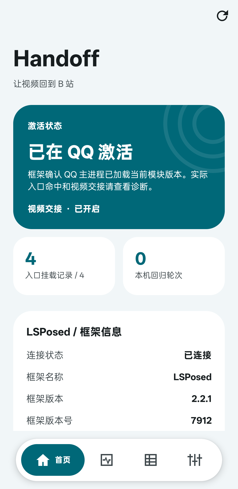
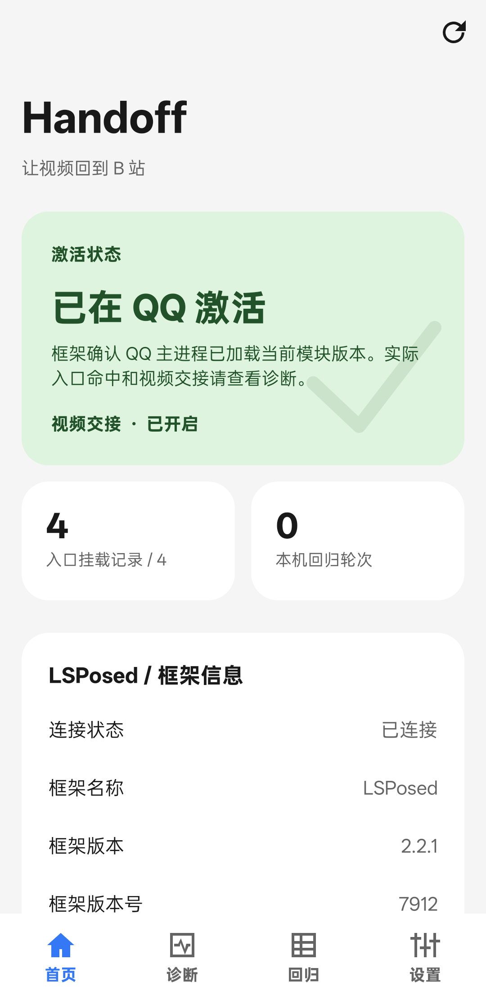
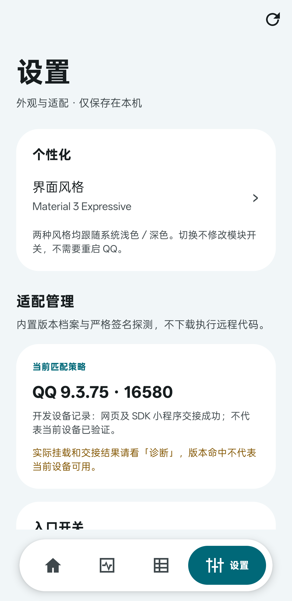
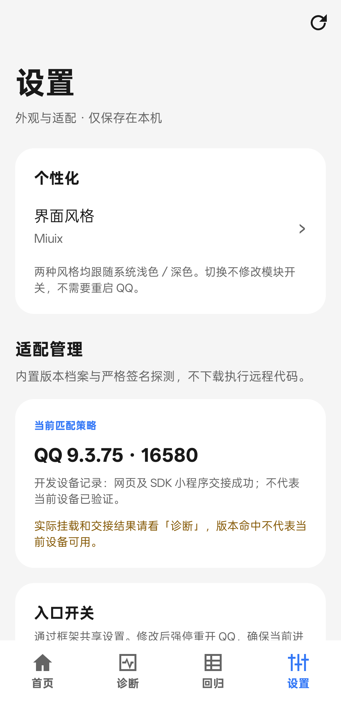

<div align="center">
  
  <h1>Handoff</h1>
  <p><strong>QQ 负责聊天，链接回到对应 App。</strong></p>
  <p>把 QQ 中支持的 B 站、抖音和快手视频链接，交给对应 App。</p>
  <p>
    <a href="https://github.com/gretae-King-1122/Handoff/releases/latest"></a>
    <a href="#环境要求"></a>
    <a href="#环境要求"></a>
    <a href="LICENSE"></a>
  </p>
  <p>
    <a href="https://github.com/gretae-King-1122/Handoff/releases/latest">下载正式版</a> ·
    <a href="#安装">安装说明</a> ·
    <a href="https://github.com/gretae-King-1122/Handoff/issues">问题反馈</a> ·
    <a href="CHANGELOG.md">更新记录</a>
  </p>
</div>

## 简介

Handoff 是一个轻量 LSPosed 模块。点击 QQ 中支持的视频卡片或链接时，
交给国内版 B 站、抖音或快手 App；保留原有外跳确认。抖音／快手交接默认关闭，可独立开启。

| 能力 | 说明 |
| --- | --- |
| 视频交接 | 浏览器／小程序多入口互补，按实际 ClassLoader 补挂 |
| 双风格界面 | Material 3 Expressive / Miuix，跟随系统浅色／深色 |
| 状态与诊断 | 展示真实激活状态、框架信息与入口信号，支持脱敏导出 |
| 回归与设置 | 绑定环境记录测试结果，提供总开关与各入口开关 |

**当前正式版：[v0.6.0](https://github.com/gretae-King-1122/Handoff/releases/tag/v0.6.0)。**
210 项 JVM／Robolectric 测试、Debug／Release 构建及 lint 检查通过。

> 正式发布不等于所有设备、QQ 版本或热更新时机均已验证；本次正式版本号 APK 未额外装机回归，开发包的用户确认范围见下。

> **v0.6.0 新增抖音／快手链接交接。** 两者仍为默认关闭的可选试验功能，独立设置，不重构 B 站现有逻辑。
> 用户已确认当前设备的抖音、快手作品长链及 `v.kuaishou.com` 短链可进入对应作品；短链后台解析失败时返回 QQ 浏览器。上述真机确认来自同源开发包，不代表所有设备均兼容。
> [抖音说明 →](DOUYIN_PILOT.md) · [快手范围与验收 →](KUAISHOU_PILOT.md)

> **开发中：0.7.0-dev 动态链接交接。** 根据已安装 App 声明的 HTTPS 链接能力发现目标，不再为每个支持 App Links 的平台单写解析器。
> 动态交接和通用短链联网展开均默认关闭；多目标或未经系统验证／用户授权的域名需确认。原 B 站／抖音／快手链路及开关保留。
> 此功能尚未真机验收，未发布到正式 Release。[原理、限制与测试方法 →](DYNAMIC_HANDOFF.md)

## 双风格真机效果图

在「设置 → 个性化 → 界面风格」切换，两套风格均跟随系统浅色／深色。
外观保存在本机，切换不修改交接开关，也不需要重开 QQ。

| Material 3 Expressive | Miuix |
| :---: | :---: |
|  |  |
|  |  |

> **真机截图**：OPPO PGZ110 · Android 16 · QQ 9.3.75 · LSPosed 2.2.1，拍摄于 2026-10-31。
> 来自 v0.4.0 发布前的同源开发包（图中仍标 v0.3.0 / 6），只裁去系统栏，未修改应用内容。
> “已激活”和挂载记录不代表视频交接已验证通过；截图过程未修改交接开关或创建回归结果。

界面视觉参考 [SukiSU-Ultra](https://github.com/SukiSU-Ultra/SukiSU-Ultra)，使用 Android Views 独立实现，
未复制其 GPL 源码或引入其 Compose 组件库。[设计与截图说明 →](UI_DESIGN.md)

## 支持范围

| 场景 | 当前状态 |
|---|---|
| 经 QQ 浏览器跳板打开的 B 站分享卡片／明文视频链接 | 支持；派发前交接，避免并行启动内置浏览器 |
| `/video/av数字`、`/video/BV…` 视频地址 | 支持 `bilibili.com`、`www.bilibili.com`、`m.bilibili.com` 的标准 HTTP(S) 地址 |
| `m.q.qq.com/a/s/…` 小程序短链 | QQ 解析出 B 站 App ID 与视频页后，在已适配的小程序启动路径交接；不凭短链前缀盲拦 |
| `b23.tv` 短链 | 模块不主动解析；只有 QQ 已解析并走支持的明文视频派发路径时才可能命中 |
| 抖音 `v.douyin.com` 短链、标准 `/video/数字ID` | 可选；短链直接交由国内抖音处理，失败不降级到首页 |
| 快手 `/fw/photo/…`、`/fw/long-video/…` 作品分享页 | 可选；限定 `v.m.chenzhongtech.com`，只交给国内快手 |
| 快手 `v.kuaishou.com` 短链 | 可选；模块后台读取受限 HTTPS 重定向，解析/启动失败时返回 QQ 原浏览器，支持取消 |
| 其他 App／域名（0.7.0-dev） | 动态试验：依据 HTTPS Intent Filter 发现已安装目标；可选后台展开 HTTP 重定向短链，不保证平台私有路由可用 |
| B 站／抖音／快手未列出的内容类型 | 不由动态路由补接，避免绕过原平台开关 |
| 开关设置 | 框架未连接或设置不可读时开关只读 |
| 自定义规则编辑、远程适配代码／热更新 | 不支持；内置契约随模块版本维护 |

目标 App 为国内版哔哩哔哩 `tv.danmaku.bili`、抖音 `com.ss.android.ugc.aweme` 和快手 `com.smile.gifmaker`。国际版、极速版、分身及其他 QQ 版本未验证。

<details>
<summary>适配原理与技术边界</summary>

小程序交接限 App ID `1109937557` 的 `pages/video/video[.html]` 页面，读取 `bvid` 或正整数 `aid`。
早期 rc.1 仅适配主进程的 `LaunchManagerService.startMiniApp(Activity, MiniAppInfo, Bundle, ResultReceiver)`：
Activity 为 `QPublicTransFragmentActivity`、无 ResultReceiver；允许普通启动附加参数，
但 Bundle 不能覆盖 `KEY_APPINFO` 或携带 `receiver` 回调。
其他入口、IPC／回调启动、身份或视频 ID 冲突、未知页面均保留 QQ 原行为；不承诺所有小程序入口已覆盖。
只读诊断探针本身仍不执行交接，也不以页面恢复通知作为新的点击。

v0.2.0 在原服务入口之外增加两层独立安装的入口：
- `MiniSDK.startMiniApp(Activity, MiniAppInfo, Bundle, ResultReceiver)`：精确匹配四参数 static void 签名，
  沿用服务入口的调用方和 Bundle／回调限制；单个入口不可用不影响其他入口。
- 主进程内的 `Activity.startActivityForResult(Intent, int, Bundle)` 派发前兜底：只接受上述调用方，
  显式目标必须为 QQ 的 `AppBrandUI`／`AppBrandUI1~3`，不接受结果请求、转发结果或 selector。
  在 Intent 副本上读取 `sdk_mode=true`、无非空 `receiver` 的 SDK `KEY_APPINFO` 模型，
  复用同一身份／视频校验，不读取登录字段、不修改原 Intent，也不在容器生命周期中二次跳转。
  此处允许尚未销毁但正在结束的过渡页：QQ 可先结束预加载页，再执行排队的启动请求；
  已销毁的调用方仍放行。SDK／服务早期入口继续要求 Activity 未结束、未销毁。

外层尚无视频信息时允许内层继续识别；同一同步调用链中相同视频只尝试一次，不跨线程或跨点击缓存。
兜底依赖 Android 派发方法和上述 QQ 契约，不等于已解决所有热更新场景或支持所有小程序入口。

### QQ 热补丁环境的运行时补挂

PJD110 的定向诊断确认：package-ready 阶段使用 PathClassLoader，Application 启动及真实派发时
使用 DelegateLastClassLoader；浏览器派发类、跳板类、MiniSDK 和服务类均出现“同名但 Class 身份不同”。
因此只挂早期类，即使报告成功，也可能不进入 QQ 实际使用的方法。

现在保留早期安装，并在主进程 `Instrumentation.callApplicationOnCreate` 执行前，按 Application 的实际
ClassLoader 补挂正常交接入口；按 Loader 身份和反射 Method 的真实声明类身份分别防重。
浏览器调用方仍限定精确类名及 Activity 类型，但不再捕获早期跳板 Class 做身份比较，避免部分补丁类被误拒。
这只用于挂载方法，不在 Application 生命周期内外跳，不替换 QQ 的 ClassLoader、不删除或禁用其补丁。
加载器提取／补挂失败时继续 QQ 原始初始化，原方法异常保持原样，不重试原调用。
2026-10-30 13:21 的修复包日志已确认网页及 SDK 小程序入口命中，用户确认成功；
尚不覆盖 Application 启动之后再次更换加载器的未知路径，也没有完成全部机型、入口和负向真机回归。

</details>

## 环境要求

- **已 root 的设备**，安装支持现代 libxposed API 的 LSPosed 兼容框架。
- 模块 `minSdk 26`，即 Android 8.0+；这只是编译下限，框架和 QQ 自身可能要求更高版本，
  **不代表所有 Android 8.0+ 设备均经过验证**。
- 真机验证环境：OPPO PGZ110／PJD110、QQ 9.3.75、LSPosed 2.2.1 / API 102。
- 2026-10-29 小程序诊断设备实际报告 QQ 9.3.5（versionCode 14540）：已确认上述四参数签名可挂载，
  视频 ID 在启动前可见；这不等于修复包已通过该版本的真机回归。
- 安装国内版哔哩哔哩，并为模块勾选 QQ `com.tencent.mobileqq` 作用域。

## 获取 APK

在 [v0.6.0 正式版](https://github.com/gretae-King-1122/Handoff/releases/tag/v0.6.0) 下载
`Handoff-v0.6.0.apk`；`SHA256SUMS.txt` 用于校验文件。正式签名兼容此前正式签名包及 0.3.0-dev，
不能覆盖 Debug 签名包。也可以自行[构建](#构建)。

> 官方 APK 使用独立发布签名。旧 debug 包无法直接覆盖安装，需先在 LSPosed 停用并卸载旧 Handoff，
> 再安装正式包、重新启用并勾选 QQ（不要卸载 QQ）。自行构建的签名也可能不同；密钥不要提交到仓库。

## 安装

1. 安装自行构建或 Releases 中的 APK。
2. 打开 LSPosed → 模块 → 启用 **Handoff**。
3. 作用域勾选 **QQ**，不需要勾选 B 站或系统框架。
4. 强制停止 QQ，再重新打开。
5. 如需抖音／快手交接，在 Handoff 设置中独立开启对应试验开关，再强停重开 QQ；只开启抖音不会自动开启快手。
6. 在 QQ 中点击支持的视频卡片／链接，按原有弹窗确认外跳。

本版提供桌面入口和框架内的模块设置入口；启用模块仍需兼容的 LSPosed 框架。
更新模块后也建议强停并重开 QQ；停用时同样操作。

## 常见问题

**点了仍打开 QQ 浏览器？**

先确认模块已启用、作用域已勾选、QQ 已强停重开，并检查链接是否属于支持范围。抖音／快手还需开启各自独立开关；快手短链无法解析时也会返回 QQ 浏览器。
QQ 内部派发路径随版本变化，不保证其他版本或其他卡片类型可用。

**为什么还有“是否跳转”的弹窗？**

模块保留原有外跳确认，不尝试绕过。外跳请求被系统接受不等于用户已经确认。
取消确认不会自动再打开 QQ 网页；此场景仍需完整真机回归。

**没有安装 B 站，或者外跳失败怎么办？**

会顺序尝试视频链接、B 站 scheme、B 站首页；同步启动均失败时放行 QQ 浏览器。
最终降级到首页不代表已打开对应视频；不可用场景仍待完整真机回归。

预发布版的小程序交接只尝试视频链接与 scheme，不把打开首页算作视频交接；启动失败时放行 QQ 小程序。

**为什么某些小程序卡片仍会打开 QQ 小程序？**

先确认使用的是包含小程序交接的源码构建包。QQ 必须先解析出可信的 App ID 和视频路径；
只剩短链、QQ 解析失败、未知启动入口或带未适配回调时都会放行，不猜视频 ID。
尚未证明卡片存在固定失效时长；可尝试重新分享或直接发送明文视频链接，但不保证解决所有入口问题。

**为什么没有立刻打开视频？**

总时长还包含人工确认、系统调度及 B 站冷启动。轻量模式减少的是模块探针与日志开销，
不能保证消除其他 App 的加载时间。

## 隐私

- 模块不上传日志、不提供遥测。开启快手功能并点击支持的短链时，模块会向 `v.kuaishou.com` 发起 HTTPS 请求，读取最多 3 次重定向；不请求作品正文、不访问未知重定向目标、不在 QQ UI 线程联网。
- B 站和抖音交接路径不由模块主动联网；QQ 及目标 App 自身的联网行为不受此声明约束。
- 0.7.0-dev 的动态目标发现仅在本机查询声明接收网页链接的 App，不上传或持久化 App 列表。通用短链联网展开另设默认关闭的开关，需同时开启动态交接；开启后，没有目标 App 的普通 HTTPS 链接也可能被请求，原站／重定向站点可见 IP 及该 URL 参数。最多 3 次请求，只检查响应状态与 Location，不解析正文／JS、不带 Cookie／Referer、不保存分享 URL；禁止内网地址、非 HTTPS 和未知 Scheme。关闭此选项时，动态路径不访问链接。
- 正常模式检查浏览器跳板的目标视频链接，以及已适配小程序启动模型中的 App ID 和候选视频路径，
  输出简短安装／命中／耗时日志；小程序外跳重建标准视频 URL，不携带分享跟踪参数。
- 诊断包额外读取并记录启动字段及调用信息，不建议长期日用或直接公开完整日志。

## 问题反馈

请在 [Issues](https://github.com/gretae-King-1122/Handoff/issues) 中提供：

- Android／系统版本、QQ 版本、LSPosed 版本、Handoff 提交或版本号。
- 卡片还是明文链接、视频 ID 类型、复现步骤、预期和实际结果。
- 已脱敏的 LSPosed Handoff 日志及复现时间；可另附主动导出的类型化报告，
  它不含完整 LSPosed 日志，也不能替代复现步骤。

`HANDOFF dispatch installed` 表示具体派发签名已挂载；
`HANDOFF blocked QQ browser` 表示该次内置浏览器派发被阻断，**不是用户确认或视频加载完成的证明**。
预发布版的 `HANDOFF mini installed` 表示小程序启动签名已挂载；`HANDOFF blocked QQ mini`
表示视频外跳请求被接受且原小程序启动被跳过，同样不代表用户已确认或视频已加载。
`HANDOFF mini pass reason=launch-failed` 表示尝试启动失败，已放行 QQ 小程序。
v0.2.0 的命中日志额外标明 `entry=sdk`／`service`／`container-dispatch`；
`HANDOFF mini container installed` 仅表示派发兜底挂载，不代表实际点击命中。
请先删除 QQ 号、聊天内容、分享链接查询参数、Token 和设备标识，再公开日志或截图。

## 构建

需要 JDK 21+、Android SDK Platform 37 和仓库内的 Gradle Wrapper；本机使用 JDK 26 验证。

<details>
<summary>展开构建、诊断与发布签名说明</summary>

需要 Git、JDK 21+ 和 Android SDK Platform 37；本机已用 JDK 26 验证。框架需提供 libxposed API 102。
使用仓库自带 Gradle Wrapper，首次构建需联网下载依赖。
通过 Android Studio 配置 SDK，或在本地 `local.properties` 中设置 `sdk.dir`，不要提交个人路径。

```powershell
git clone https://github.com/gretae-King-1122/Handoff.git
cd Handoff

# Windows PowerShell；默认关闭诊断探针
.\gradlew.bat :app:assembleDebug :app:assembleRelease

# 单元测试
.\gradlew.bat :module-hook-lsposed:testDebugUnitTest

# 仅研究小程序时开启完整探针
.\gradlew.bat :app:assembleDebug -PhandoffDiagnostics=true

# 仅排查小程序启动边界，不开启完整探针或记录原始链接
.\gradlew.bat :app:assembleDebug -PhandoffBoundaryDiagnostics=true
```

macOS／Linux 将 `.\gradlew.bat` 换为 `./gradlew`；若无执行权限，先运行 `chmod +x gradlew`。

- Debug：`app/build/outputs/apk/debug/app-debug.apk`
- Release：`app/build/outputs/apk/release/app-release.apk`

官方 Release 需要本地签名配置：默认读取 `~/.handoff/release-signing/signing.properties`，
或通过环境变量 `HANDOFF_SIGNING_PROPERTIES` 指定；包含 `storeFile`、`storePassword`、
`keyAlias`、`keyPassword`（PKCS12）。没有配置时只生成 `app-release-unsigned.apk`，不能直接安装；
自行体验可构建 Debug。Release 始终关闭诊断探针。

正常包应记录 `diagnostics=false`。诊断包仅适合排查问题，切回日常包时去掉构建参数并重新构建、安装。
定向边界诊断包另有 `boundaryDiagnostics=true` 和 `[DEBUG-mini-boundary]` 标记；正常包应为
`boundaryDiagnostics=false`。两个诊断开关在 Release 中均强制关闭；定向诊断不改变拦截规则。
如果安装后仍出现旧日志，可追加 `--no-build-cache --rerun-tasks` 强制构建；不要仅凭安装成功判断实现已更新。

Windows 中文工作目录下若测试 worker 报已编译测试类找不到，可尝试仅对该命令覆盖 daemon 编码：

```powershell
.\gradlew.bat :module-hook-lsposed:testDebugUnitTest --no-configuration-cache '-Dorg.gradle.jvmargs=-Xmx3g -Dfile.encoding=GBK'
```

这不是源码编码变更，不要据此修改项目的 UTF-8 配置。

</details>

## 更新记录

见 [CHANGELOG.md](CHANGELOG.md)。

## License

[Apache-2.0](LICENSE) © 2026 Handoff Project Contributors

## 免责

本项目为非官方实验性模块，与腾讯、哔哩哔哩、抖音、快手无关联。不修改网络、不伪造设备指纹，也不规避风控。
Root 与 Hook 第三方应用可能造成崩溃、兼容性或账号风险；不保证零封号风险。
请自行评估，避免用于主力账号的支付、登录等关键场景。取消确认、外跳失败、非 B 站与连续点击仍需完整回归。
